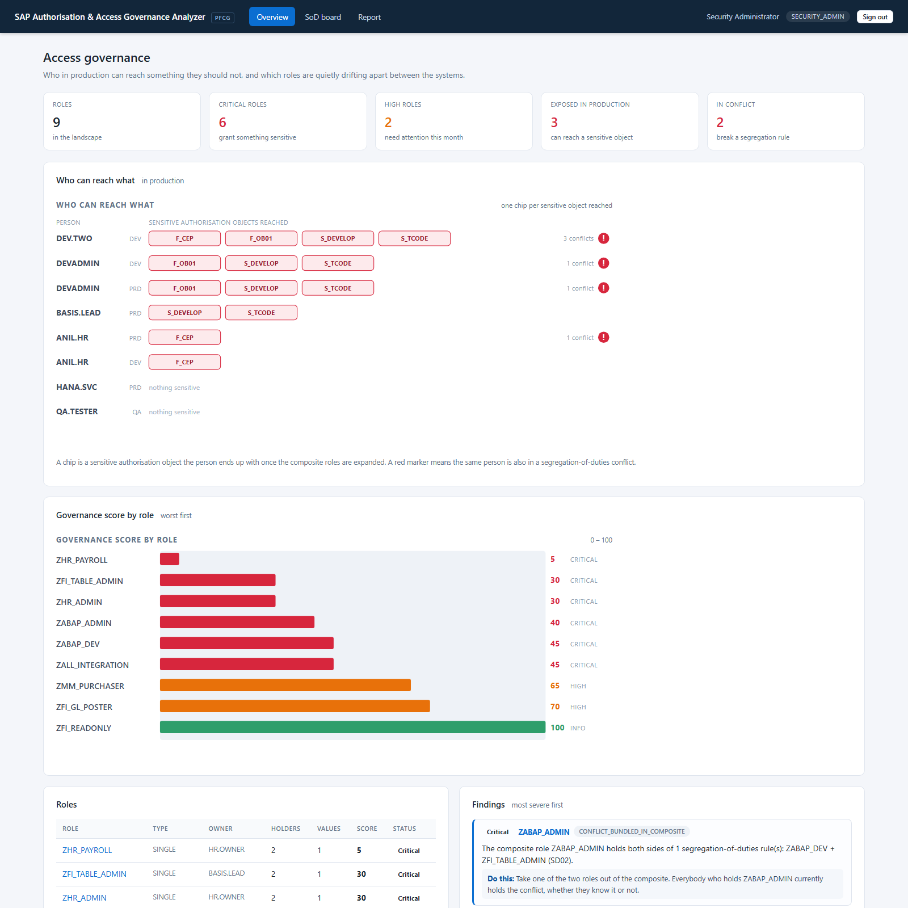
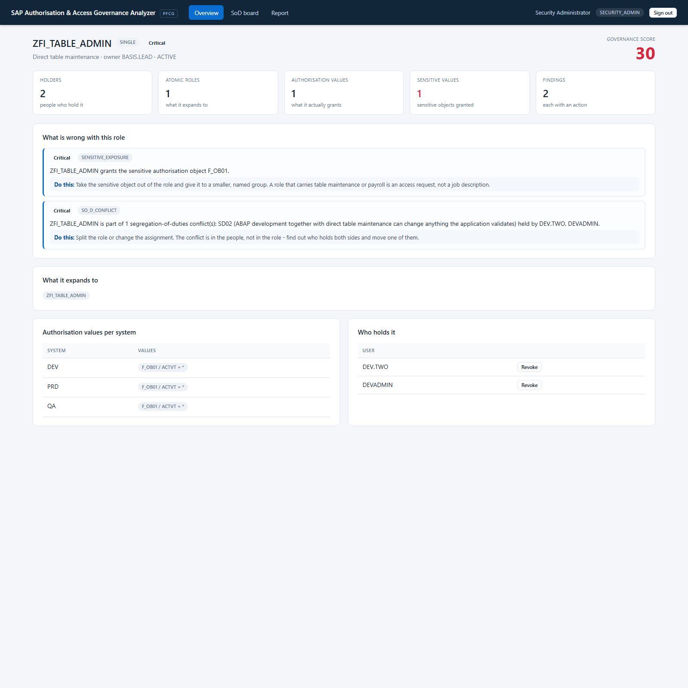
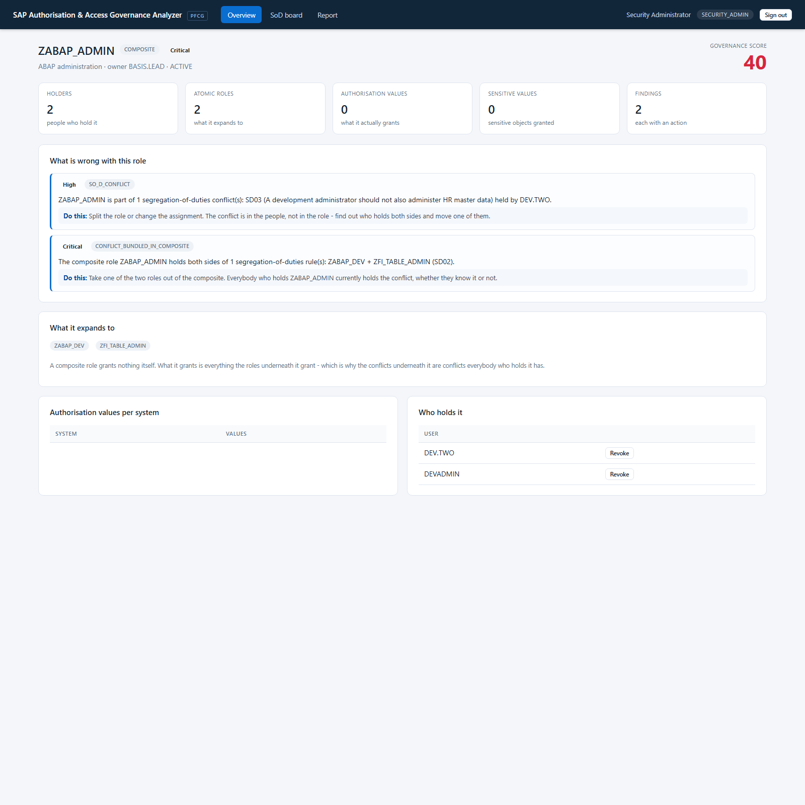
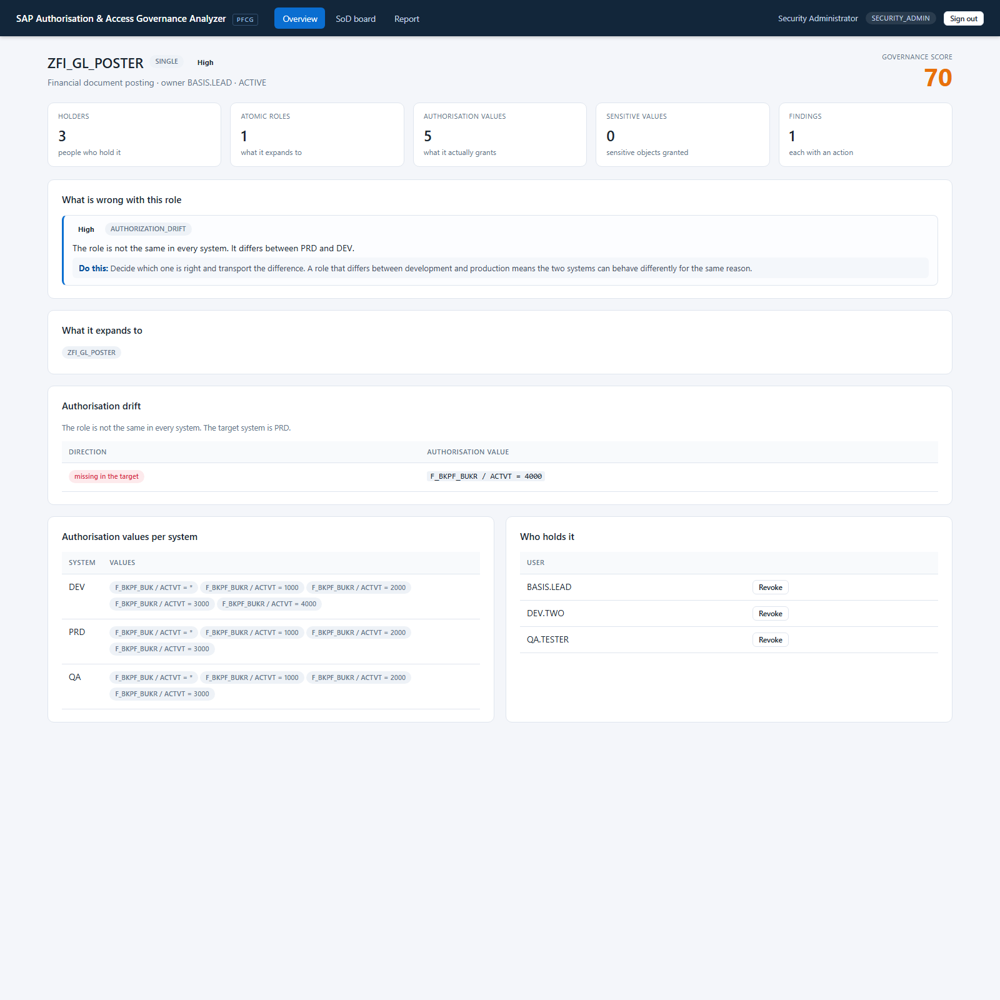
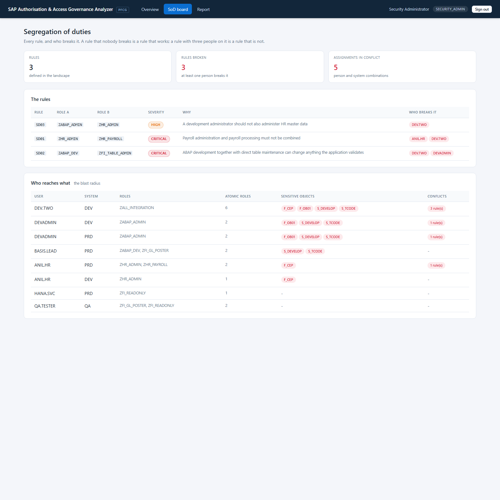
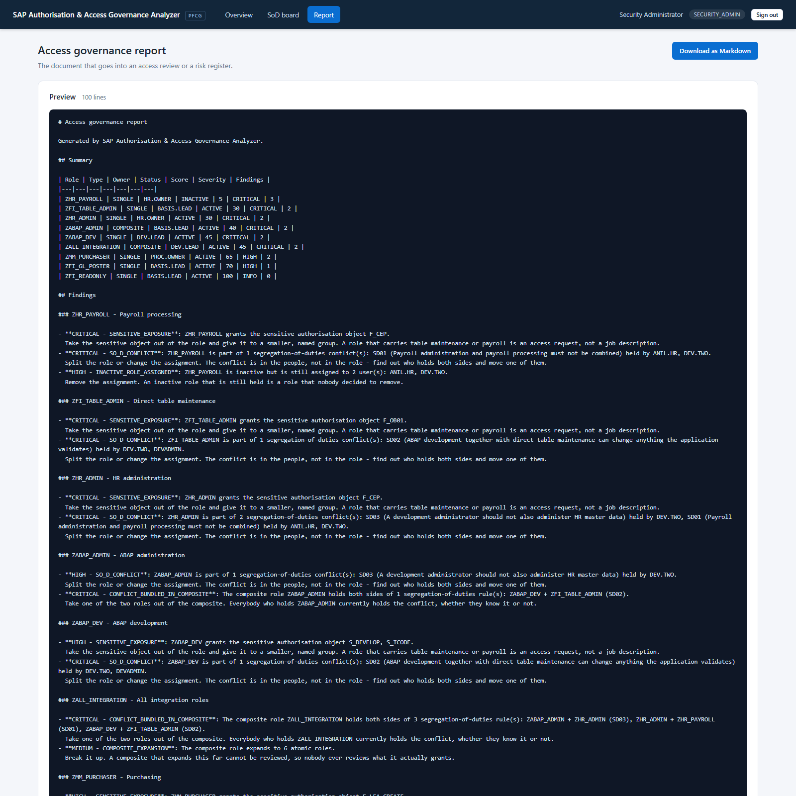
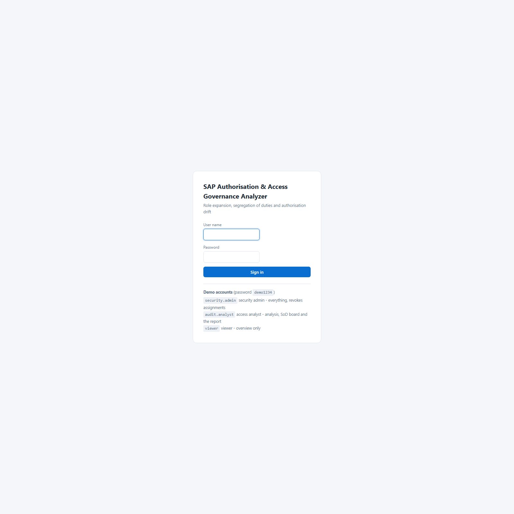

<div align="center">

# SAP Authorisation &amp; Access Governance Analyzer

**Access governance for SAP landscapes — role expansion, segregation-of-duties conflicts, authorisation drift between systems, sensitive exposure and a per-role governance score**


</div>

---

## The problem

*"Who can actually do what?"*

That is the question a security team asks, and the role list is the wrong
place to answer it. A role name on its own is not an authorisation — **the
authorisation is the whole expansion, held by a person, in a system.**

Three things hide behind the role list:

1. **The composite.** `ZABAP_ADMIN` grants nothing itself. It grants
   everything the roles underneath it grant — and if two of those roles
   conflict, *everybody* who holds the composite has the conflict, whether
   they know it or not.
2. **The person.** The conflict is not in the role, it is in the **pair of
   roles one person holds**. Two roles are fine until somebody holds both.
3. **The other system.** The same role with a different set of values in
   development and production means the two systems can behave differently
   for exactly the same reason.

This analyzer works on the expansion, not on the role list:

1. **What can this role actually do?** — the authorisation values it holds,
   and whether any of them is sensitive enough to be a finding on its own.
2. **Who holds it together with what?** — the segregation-of-duties
   conflicts, and *who* is in them. That is the blast radius.
3. **Does the composite bundle a conflict?** — a composite that holds both
   sides of a rule hands the conflict to everybody who holds it.
4. **Is it the same in every system?** — the same role with different values
   in development and production is authorisation drift.
5. **Is an inactive role still assigned? How far does the composite expand?
   Does anybody hold it? Does it have an owner?**

The result is a per-role governance score **and the findings behind it** —
plus the one picture that makes the landscape legible: **who can reach what**.

---

## Screenshots

### Who can reach what — the blast radius

> `DEVADMIN` reaches `F_OB01`, direct table maintenance, in **production** —
> because the composite hands it the role underneath. Three people in production
> can reach a sensitive object, and two of them are in a segregation-of-duties
> conflict.



### ZFI_TABLE_ADMIN — a role that grants direct table maintenance



### ZABAP_ADMIN — a composite that bundles a conflict



### ZFI_GL_POSTER — the same role, different values in every system



### The segregation-of-duties board — every rule, and who breaks it



### The access governance report



### Sign in



---

## Run it

### Requirements

* **Java 8 or newer** (the code targets Java 8 and `javax.servlet`, so it can
  be deployed on the NetWeaver 7.5 Java stack)
* **Maven 3.6+**
* Nothing else. No SAP system, no SAP licence, no database server.

```bash
git clone https://github.com/Revanth2716/sap-authorization-analyzer.git
cd sap-authorization-analyzer
mvn clean package
java -jar target/sap-authorization-analyzer.jar
```

Open <http://localhost:8087> and sign in:

| User | Role | Sees |
|---|---|---|
| `security.admin` | SECURITY_ADMIN | Everything, including revoking a role assignment |
| `audit.analyst` | ANALYST | The analysis, the SoD board and the report |
| `viewer` | VIEWER | The overview only |

Password: `demo1234` (configurable; switch the accounts off with
`access.seed-demo-users=false`).

### Run the tests

```bash
mvn test
```

```
Tests run: 58, Failures: 0, Errors: 0, Skipped: 0
BUILD SUCCESS
```

---

## The landscape it ships with

Nine roles, each with the problem a real customer has:

| Role | Score | Status | The story |
|---|---|---|---|
| **ZHR_PAYROLL** | 5 | CRITICAL | Grants **payroll processing**, is **inactive but still assigned**, and sits in a conflict with the HR administration role. |
| **ZFI_TABLE_ADMIN** | 30 | CRITICAL | Grants **direct table maintenance**. Nobody holds it directly — they all get it through a composite. |
| **ZHR_ADMIN** | 30 | CRITICAL | Grants **payroll display** and is held together with payroll processing by one person. |
| **ZABAP_ADMIN** | 40 | CRITICAL | A composite that **bundles a segregation conflict**, so every holder has it whether they know it or not. |
| **ZABAP_DEV** | 45 | CRITICAL | Grants ABAP development, and is held together with table maintenance by one person. |
| **ZALL_INTEGRATION** | 45 | CRITICAL | A composite that expands to **six atomic roles** and bundles **three** conflicts. |
| **ZMM_PURCHASER** | 65 | HIGH | Grants vendor creation and **nobody holds it**. |
| **ZFI_GL_POSTER** | 70 | HIGH | The **same role with a different set of company codes** in development and production. The drift. |
| **ZFI_READONLY** | 100 | INFO | Grants display only. Clean. The control. |

**Three people in production can reach a sensitive authorisation object, and
two of them are in a segregation-of-duties conflict.** That is the whole
story, and it is the sentence a security review opens with.

---

## Architecture

```
                    ┌────────────────────────────────────────┐
                    │        web layer (Spring MVC)          │
                    │  Overview · Role detail · SoD board ·   │
                    │  Report · REST API                     │
                    └───────────────────┬────────────────────┘
                                        │
                    ┌───────────────────▼────────────────────┐
                    │            service layer               │
                    │  AccessGovernanceService                │
                    │    · role expansion (atomic + effective) │
                    │    · segregation-of-duties conflicts     │
                    │    · authorisation drift between systems│
                    │    · sensitive exposure and blast radius │
                    │    · severity = the worst finding       │
                    │  AuditService                          │
                    └───────────────────┬────────────────────┘
                                        │
                    ┌───────────────────▼────────────────────┐
                    │       repository layer (JdbcTemplate)   │
                    │  AUTH_ROLE · AUTH_OBJECT · AUTH_VALUE ·  │
                    │  AUTH_ROLE_VALUE · AUTH_USER_ROLE ·      │
                    │  AUTH_SOD · AUTH_SYSTEM                   │
                    └───────────────────┬────────────────────┘
                                        │
              ┌─────────────────────────┴─────────────────────────┐
              │                                                   │
   ┌──────────▼───────────┐                        ┌──────────────▼─────────────┐
   │  H2 (local, seeded)  │                        │  SAP HANA                  │
   │  the demo database   │                        │  live NetWeaver landscape  │
   └──────────────────────┘                        └────────────────────────────┘
```

Five decisions carry the project:

**1. Two different expansions.**
The **atomic** roles are the leaves — what a role really grants. The
**effective** roles are the whole chain, composites included. A rule that
names a composite can only be broken by a person who holds the composite, and
the leaves alone would never match it. Both are needed, and they are not the
same thing.

**2. The segregation check is per person, not per assignment.**
A person holding two conflicting roles normally holds them in **two separate
assignments**. Checking one assignment at a time finds nothing at all — which
is the most natural way to write the check and completely wrong.

**3. A composite that bundles a conflict is a finding of its own.**
Everyone who holds the composite has the conflict, including the people who
have never heard of it. Reporting it only on the two atomic roles would put
the finding on roles nobody holds.

**4. Drift means the same role with different values — so both copies have to
exist.**
A role that exists in production and not in development is not drift; it is a
role that was never created in development. Comparing a role with a role that
is not there is a false positive, and false positives are how a governance
tool gets ignored.

**5. The severity is the worst finding, not the score band.**
`ZMM_PURCHASER` scores 65 — "high" on a score band — and is **high**. But
`ZFI_TABLE_ADMIN` also scores 30 and is **critical**, because a role that
grants table maintenance is not the same kind of problem as a stale one.

---

## The SAP-side artifacts

The ABAP and the RFC client that a live NetWeaver system would talk to are
included. They are written against NetWeaver 7.5 semantics and are **ready to
compile**; they have not been executed on a live system, because none was
available when this was built (see [`docs/HONEST-STATUS.md`](docs/HONEST-STATUS.md)).

| File | Purpose |
|---|---|
| `abap/Z_AUTH_EXPOSURE.abap` | RFC-enabled function module reading the roles from `AGR_ROLES`, the authorisation values from `AGR_AUTH` and the assignments from `AGR_USERS` |
| `abap/Z_AUT_TYPES.abap` | The DDIC structures (`ZAUT_ROLE`, `ZAUT_USER`) the module imports and exports |
| `src/extra/java/.../RfcAccessGateway.java` | JCo client that calls it over an RFC destination maintained in `SM59` |
| `src/main/java/.../AccessGateway.java` | The interface that keeps RFC out of the rest of the code |

> **The one line that decides whether RFC works at all:** create the function
> module in `SE37` with **Remote-Enabled** ticked. Without it the call fails
> with *"function module not found / not remote enabled"* — and the error
> surfaces as an `SM58` entry on the **calling** system, not as a dump on the
> callee.

> **What the function module deliberately does not do:** decide whether two
> roles conflict. The segregation-of-duties rules are a customer's own
> policy, and the sensitivity of an object — table maintenance is critical,
> display is not — is a judgement a security team makes. The database holds
> the facts; the policy belongs in the analyzer.

---

## Moving to a live SAP system

```bash
mvn -Pwith-jco clean package     # adds the JCo RFC adapter
mvn -Phana   clean package       # adds the SAP HANA JDBC driver
```

Then set `access.gateway: jco` and copy `jco.properties.example` to
`jco.properties`. The SQL is portable ANSI, so pointing the datasource at
HANA is a configuration change, not a code change. Full detail in
[`docs/DEPLOYMENT.md`](docs/DEPLOYMENT.md).

---

## Testing

58 tests across five classes:

| Test class | What it locks in |
|---|---|
| `AccessGovernanceServiceTest` | Each rule on its own — a critical object, a high object, a normal object, two people holding both sides of a rule, a composite that bundles a conflict, a composite that expands too far, drift in one direction and not in the other, an inactive role still assigned, an orphaned role — and that **the severity is the worst finding, not the score band**, and that **a less severe rule still costs something** |
| `AccessLandscapeTest` | The story the seeded landscape has to tell, role by role, and the blast radius: three people exposed in production, two in conflict |
| `StartupGateTest` | The application is closed until the seeders have run |
| `ApiControllerTest` | The REST API, that it is authenticated, that the health check is open, and that it never leaks a stack trace |
| `PageRenderTest` | **Every screen renders** — a template can compile and the service layer can be green while one page still returns HTTP 500 |

Three real bugs were caught by these tests while the project was being built,
and all three were **logic** bugs rather than typos:

* a person holding two conflicting roles in **two separate assignments** was
  not detected at all, because the check looked at one assignment at a time;
* a role held only **through a composite** was reported as an orphan,
  because "nobody holds it" was checked against the direct assignments only;
* a **high-severity** segregation conflict produced a finding that **cost
  nothing** — a finding nobody has to act on.

---

## Resume content

Copy-paste blocks are in [`docs/RESUME.md`](docs/RESUME.md). The short form:

> **SAP Authorisation & Access Governance Analyzer** — access governance for SAP landscapes
> *Java 8 · Spring Boot 2.7 · JdbcTemplate · SAP HANA · ABAP RFC · SAP Java Connector*
>
> - Built an **access governance analyzer** for SAP landscapes that evaluates **segregation-of-duties conflicts across the whole composite expansion** — including the composite that bundles a conflict and hands it to every holder — detects **authorisation drift** where the same role holds different values in development and production, and computes the **blast radius** of each person in production.
> - Modelled the distinction that a role list cannot express: the **atomic** roles a role really grants versus the **effective** roles a person ends up holding, and made the segregation check **per person rather than per assignment**, so a conflict held through two separate role assignments is actually found.
> - Shipped the SAP-side artifacts (**RFC-enabled ABAP function module** reading `AGR_ROLES`/`AGR_AUTH`/`AGR_USERS`, **SAP Java Connector client** behind an optional Maven profile) on **portable ANSI SQL** that runs unchanged on local H2 and SAP HANA, with **58 automated tests**.

---

## Honest status

| | |
|---|---|
| **Works and is tested today** | the whole application: 58 tests green, the JAR builds, every screen is rendered from the running app |
| **Written but not compiled against SAP** | the ABAP function module, the DDIC types, the JCo adapter — no NetWeaver system and no access to SAP's Maven repository |
| **Modelled, not measured** | the roles, the authorisation values, the assignments and the segregation rules are a seeded synthetic dataset, not a customer's landscape |
| **Known limitation** | the **sensitivity of an authorisation object is a judgement, not data** — the database does not know that table maintenance is critical and display is not, so that judgement is maintained in the portal |

Full detail, and the step that closes each gap, in
[`docs/HONEST-STATUS.md`](docs/HONEST-STATUS.md).

---

## Documentation

| Document | Read it when |
|---|---|
| [`ARCHITECTURE.md`](docs/ARCHITECTURE.md) | You want to know why it is built this way |
| [`DEPLOYMENT.md`](docs/DEPLOYMENT.md) | You are moving it to a real SAP landscape |
| [`TROUBLESHOOTING.md`](docs/TROUBLESHOOTING.md) | A finding looks wrong, or an RFC call fails |
| [`RESUME.md`](docs/RESUME.md) | You are putting this on a CV |
| [`INTERVIEW-QA.md`](docs/INTERVIEW-QA.md) | You are preparing to be asked about it |
| [`HONEST-STATUS.md`](docs/HONEST-STATUS.md) | You need to know exactly what to claim |
| [`LEARNING-LOG.md`](docs/LEARNING-LOG.md) | You want to see the thinking behind the code |

---

## Roadmap

- [ ] Compile and run the ABAP and JCo artifacts against NetWeaver 7.5
- [ ] Read the **authorisation object catalogue** with its sensitivity
      marking, so the critical/normal judgement comes from the customer's own
      object list rather than from the portal
- [ ] Detect the **profile-vs-role** case: a profile that grants more than the
      role it is attached to
- [ ] Model the **emergency access** case: a firefighter role with a
      log-recording requirement
- [ ] Track the drift over time — "this role has differed between the systems
      since March" is a question the tool cannot answer yet
- [ ] Read the **authorisation values of a user directly**, not only through
      their roles, so a direct grant is not missed

---

## License

MIT — see [LICENSE](LICENSE).

This is a self-initiated portfolio project. SAP, NetWeaver, ABAP, SAP HANA,
PFCG, SU01, SU53 and the table and transaction codes referenced here are
trademarks of SAP SE and are used for technical reference and educational
purposes.
